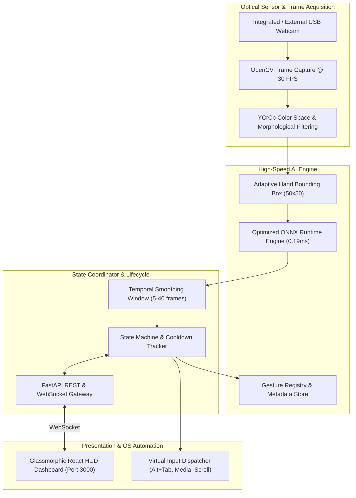

# GestureOS: AI-Powered Gesture Control Desktop Platform

[](https://python.org)
[](https://react.dev/)
[](https://www.typescriptlang.org/)
[](https://fastapi.tiangolo.com/)
[](https://onnxruntime.ai/)
[](https://opencv.org/)
[](file:///pytest.ini)

> **GestureOS** is a zero-latency computer vision desktop product that turns standard webcam video streams into hands-free operating system automation. Built with an optimized ONNX inference pipeline (<0.2ms latency), a FastAPI + WebSocket telemetry gateway, and a glassmorphic React dashboard.

---

## Key Features

- **Sub-Millisecond Inference (<0.2ms)**: Quantized CNN architecture powered by **ONNX Runtime**, processing over 5,000 frames/sec on standard CPU.
- **Modern Glassmorphic Dashboard**: React 18 + Vite + TypeScript web interface featuring live video HUD, detection reticles, gesture cards, and real-time sliders.
- **Real-Time Telemetry & WebSocket Streaming**: Bidirectional WebSocket connection (`/ws`) broadcasting state transitions, confidence scores, and action execution logs.
- **Reliable Windows Virtual HID Automation**: Native cross-platform keyboard, mouse scroll, and media key automation with thread-safe debounce and cooldown tracking.
- **Temporal Smoothing Engine**: Eliminates false positives and jitter through multi-frame temporal voting algorithms.
- **One-Command Bootstrapper**: Single unified launcher (`python run.py`) orchestrating backend, frontend, health checks, and browser launch.

---

## System Architecture



---

## Gesture-to-Action Mapping Matrix

GestureOS comes preconfigured with 9 recognized gestures mapped to standard OS controls:

| Gesture Name | Primary Action | Default Trigger Key / Operation | Default Cooldown |
| :--- | :--- | :--- | :--- |
| **App Switch** | Keyboard Shortcut | `Alt + Tab` | 500 ms |
| **Close Window** | Keyboard Shortcut | `Alt + F4` | 500 ms |
| **Play / Pause** | Keyboard Key | `Space` | 300 ms |
| **Volume Up** | Media Key | `Volume Up` | 200 ms |
| **Volume Down** | Media Key | `Volume Down` | 200 ms |
| **Scroll Up** | Mouse Action | `Vertical Scroll (+200 units)` | 100 ms |
| **Scroll Down** | Mouse Action | `Vertical Scroll (-200 units)` | 100 ms |
| **Screenshot** | Keyboard Key | `Print Screen` | 1000 ms |
| **Nothing** | Idle | *No action taken* | 0 ms |

*Note: All cooldown durations, parameter values, and activation toggles can be adjusted dynamically in real time from the dashboard.*

---

## Quickstart Guide

### 1. Prerequisites
- **Python 3.10+** (Python 3.12 recommended)
- **Node.js 18+** & **npm**

### 2. Installation
```bash
# Clone the repository
git clone https://github.com/shlokbshetty/GestureOS.git
cd GestureOS

# Install Python dependencies
pip install -r requirements.txt

# Install Frontend dependencies
cd frontend
npm install
cd ..
```

### 3. Launch GestureOS (One Command)
```bash
python run.py
```
This automatically:
1. Starts the FastAPI backend service at `http://127.0.0.1:5000`
2. Verifies backend health and loads the ONNX gesture model
3. Boots the Vite React dashboard at `http://localhost:3000`
4. Launches your default web browser

#### Available Launch Options:
```bash
# Run in simulated mock mode without camera hardware
python run.py --mock

# Run only the backend API server
python run.py --backend-only --port 5000

# Run without opening the browser
python run.py --no-browser
```

---

## Project Structure

```
GestureOS/
├── backend/                        # Python backend service
│   ├── engine.py                   # Core vision pipeline & camera capture
│   ├── controller.py               # Windows virtual keyboard/mouse automation
│   ├── gesture_registry.py         # Gesture-to-action configuration store
│   ├── state_manager.py            # Application lifecycle & state machine
│   ├── api_server.py               # FastAPI REST endpoints & WebSocket server
│   ├── main.py                     # Backend service entry point
│   ├── models/                     # AI/ML models & runners
│   │   ├── export_model.py         # ONNX model builder & exporter
│   │   └── model_runner.py         # Sub-millisecond ONNX Runtime engine
│   └── utils/                      # Utilities & helpers
│       ├── config.py               # Configuration file manager
│       ├── debounce.py             # Debounce timer & cooldown tracker
│       ├── logger.py               # Structured rotating file logger
│       └── smoothing.py            # Multi-frame temporal smoother
│
├── frontend/                       # Modern React Dashboard
│   ├── src/
│   │   ├── components/             # Reusable UI widgets
│   │   │   ├── Header.tsx          # Status indicators & latency meters
│   │   │   ├── ControlPanel.tsx    # Start/Stop/Pause buttons & metrics
│   │   │   ├── CameraHUD.tsx       # Live tracking reticle & confidence bar
│   │   │   ├── GestureCards.tsx    # 9 interactive gesture classifiers
│   │   │   ├── ActionLogFeed.tsx   # Real-time action stream
│   │   │   └── ConfigPanel.tsx     # Dynamic sliders & toggle switches
│   │   ├── hooks/useWebSocket.ts   # Auto-reconnecting WebSocket client
│   │   ├── services/api.ts         # REST API client
│   │   ├── index.css               # Glassmorphic design system
│   │   └── App.tsx                 # Root dashboard application
│   ├── vite.config.ts              # Vite dev server & proxy configuration
│   └── package.json                # Frontend dependencies
│
├── config.json                     # Application & gesture mappings config
├── pytest.ini                      # Unified test runner configuration
├── requirements.txt                # Python dependencies
├── run.py                          # Unified product launcher
└── README.md                       # Product documentation
```

---

## Testing & Quality Assurance

GestureOS features a 100% comprehensive test suite covering all modules:

```bash
# Run the complete test suite
pytest

# Results: 200 passed in ~9 seconds
```

Module breakdown:
- `test_engine.py`: Skin detection, YCrCb thresholding, and camera pipeline (44 tests)
- `test_api_server.py`: REST endpoints, WebSocket streaming, and error handling (7 tests)
- `test_controller.py`: Keyboard shortcuts, mouse scroll, and keybindings (31 tests)
- `test_gesture_registry.py`: Gesture metadata, configuration persistence, and resets (23 tests)
- `test_state_manager.py`: State machine transitions and cooldown logic (37 tests)
- `test_debounce.py`: Cooldown tracker and debouncing (4 tests)
- `test_smoothing.py`: Temporal smoothing confirmation and noise filtering (4 tests)
- `test_config.py` & `test_logger.py`: Configuration and rotating logging (47 tests)
- `test_main.py`: Application orchestration and signal handling (3 tests)

---

## License

MIT License. Designed and maintained for production-grade computer vision human-computer interaction.
