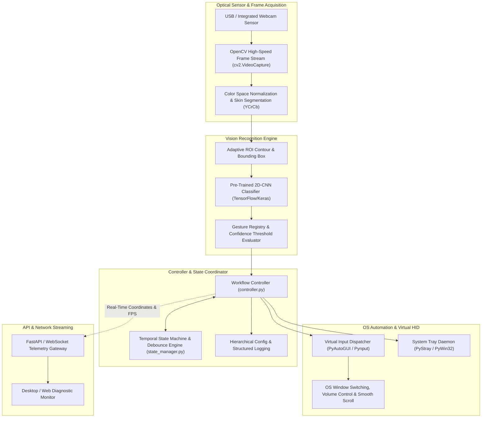

# GestureOS: Computer Vision Desktop Automation Platform

[](https://python.org)
[](https://opencv.org/)
[](https://tensorflow.org/)
[](https://fastapi.tiangolo.com/)
[](https://pyautogui.readthedocs.io/)
[](LICENSE)

> **Real-time computer vision human-computer interface translating camera-captured hand kinematic gestures into zero-latency operating system automation events and virtual input streams.**

---

## Architecture & Data Flow Diagram



---

## Core Features

- **Real-Time Morphological Kinematic Tracking**: High-throughput optical frame parsing leveraging YCrCb chroma-subsampling and morphological filtering to segment hand regions under diverse ambient lighting.
- **Deep CNN Gesture Classification**: Multi-class deep convolutional network capable of distinguishing static and dynamic hand poses with high precision and sub-20ms inference latency.
- **Adaptive Debounce & Temporal State Engine**: Temporal windowing algorithm preventing accidental multi-triggering, ensuring smooth gesture transitions and stable gesture lock.
- **Direct OS-Level Hardware Synthesis**: Direct dispatch into Windows user32/pywin32 event loops, supporting smooth scroll velocity, system audio step adjustments, screenshot captures, and active application cycling.
- **Extensible Gesture-Action Registry**: Declarative JSON mapping matrix enabling users to dynamically customize key combinations, hotkeys, and shell macros mapped to individual gestures.
- **Asynchronous Telemetry Stream**: Integrated FastAPI WebSocket and REST server streaming live confidence levels, recognized gesture states, and framerate telemetry to desktop dashboards.

---

## Tech Stack Directory

| Layer | Technologies |
| :--- | :--- |
| **Computer Vision Core** | OpenCV (4.8+), NumPy, Pillow, YCrCb Segmentation Engine |
| **Machine Learning Core** | TensorFlow 2.14+, Keras Deep Learning Framework |
| **OS Automation & HID** | PyAutoGUI, Pynput, PyStray, PyWin32 Win32 API Bindings |
| **Service & Telemetry** | FastAPI, Uvicorn, WebSockets, Pydantic v2 |
| **Testing & Quality** | Pytest, Pytest-Cov, Flake8, Black, MyPy Static Type Checker |

---

## Quickstart & Verification

### Prerequisites
- **Python**: `3.10` or higher
- **Webcam**: Standard USB or built-in webcam
- **OS**: Windows 10/11 (Optimized for Win32 API; Linux/macOS compatible)

### Environment Configuration
Copy `.env.example` (or generate `.env`) from configuration defaults:

```env
# Runtime Environment
LOG_LEVEL=INFO
CAMERA_INDEX=0
DETECTION_CONFIDENCE_THRESHOLD=0.85
DEBOUNCE_INTERVAL_SECONDS=0.5

# Telemetry Server
API_HOST=127.0.0.1
API_PORT=8080
```

### Installation & Execution
```bash
# 1. Initialize and activate virtual environment
python -m venv venv
.\venv\Scripts\activate

# 2. Install core vision and automation libraries
pip install -r requirements.txt

# 3. Execute unit and regression test suite
pytest -v backend/

# 4. Launch the gesture recognition controller daemon
python -m backend.controller
```

---

## API & Service Specification

| Protocol | Route / Channel | Direction | Payload Schema | Functional Action |
| :--- | :--- | :--- | :--- | :--- |
| `GET` | `/health` | Inbound | None | Verify camera acquisition loop and model health |
| `GET` | `/api/gestures` | Inbound | None | Fetch all registered gesture definitions and bindings |
| `POST` | `/api/gestures/map`| Inbound | `{ gesture_id: str, action: str }` | Dynamically override gesture keyboard shortcut mapping |
| `WS` | `/ws/telemetry` | Bidirectional | Continuous JSON: `{ fps, gesture, confidence }` | Real-time optical inference streaming to UI clients |
| `POST` | `/api/controller/toggle` | Inbound | `{ enabled: boolean }` | Pause or resume physical HID input interception |
