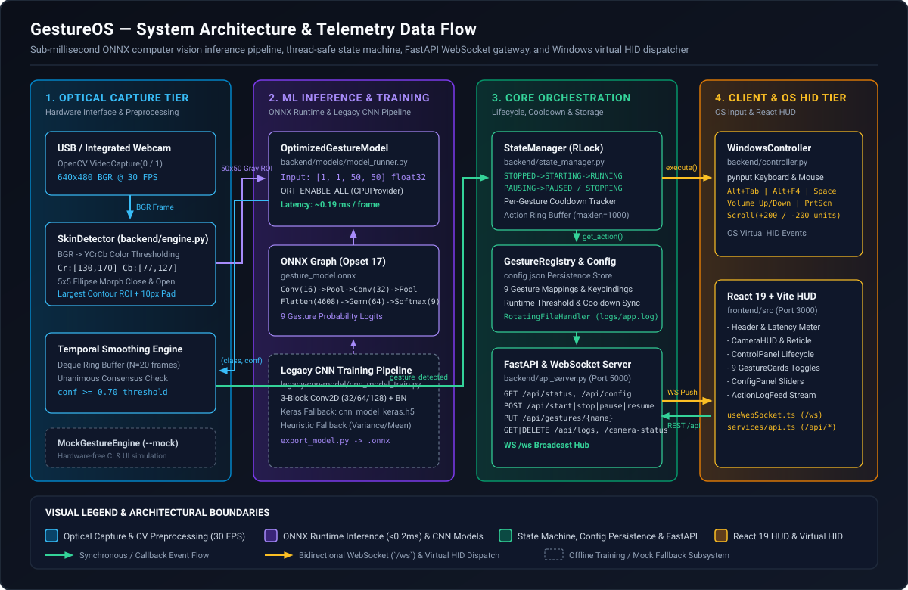

# GestureOS — System Architecture

## 1. Executive Summary

GestureOS is a real-time human-computer interaction (HCI) platform that translates optical hand gestures captured from a standard webcam into native Windows operating system actions (`Alt+Tab`, `Alt+F4`, media playback controls, volume adjustments, screenshots, and mouse scrolling). To achieve imperceptible latency alongside zero false-positive triggers, GestureOS combines a deterministic YCrCb skin-segmentation pipeline with an ONNX Runtime Convolutional Neural Network (`~0.19 ms` inference time), a unanimous ring-buffer temporal smoother, a thread-safe finite state machine, and an event-driven FastAPI + WebSocket telemetry gateway connected to a React 19 HUD dashboard.

---

## 2. System Overview Diagram



### Visual Legend Key

| Tier / Symbol | Color / Style | Architectural Responsibility |
| :--- | :--- | :--- |
| **1. Optical Capture Tier** | Cyan (`#38bdf8`) | OpenCV webcam acquisition (`640x480 @ 30 FPS`), YCrCb skin segmentation, elliptical morphological filtering, and `50x50` ROI extraction (`backend/engine.py`). |
| **2. ML Inference & Training Tier** | Purple (`#a78bfa`) | Sub-millisecond ONNX Runtime session (`OptimizedGestureModel`), deterministic ONNX graph exporter (`export_model.py`), Keras `.h5` loader, and heuristic fallback (`backend/models/`). |
| **3. Core Orchestration Tier** | Emerald (`#34d399`) | Thread-safe `StateManager`, per-gesture `CooldownTracker`, `GestureRegistry` & `ConfigManager` (`config.json`), rotating file logger (`logs/app.log`), and `APIServer` (`backend/api_server.py`). |
| **4. Client & OS HID Tier** | Amber (`#fbbf24`) | `WindowsController` virtual input synthesis via `pynput` (`backend/controller.py`) and the React 19 + TypeScript + Vite dashboard (`frontend/`). |
| **Solid Emerald Arrows** | `-->` (`#34d399`) | In-process synchronous calls, callback registrations, and REST `/api/*` request-response cycles. |
| **Solid Amber Arrows** | `-->` (`#fbbf24`) | Asynchronous WebSocket (`/ws`) push broadcasts and OS-level virtual HID event dispatch. |
| **Dashed Slate Boxes** | `- - -` (`#64748b`) | Offline training scripts (`legacy-cnn-model/`) and hardware-free simulation (`MockGestureEngine`). |

---

## 3. Core Design Patterns

1. **Observer / Event-Callback Pattern**:
   - `GestureEngine`, `StateManager`, and `WindowsController` remain decoupled from the web layer by exposing `.register_callback(callable)` hooks.
   - During startup in `GestureOSApplication.initialize()` (`backend/main.py`), callbacks are wired so that:
     - `engine` emits `gesture_detected` and `camera_error` events to `state_manager.on_gesture_detected` and `api_server.broadcast_event`.
     - `state_manager` emits `state_changed` events to `api_server.broadcast_event`.
     - `controller` emits `action_executed` and `action_failed` events to `api_server.broadcast_event`.
2. **Finite State Machine (FSM)**:
   - `StateManager` enforces strict lifecycle transitions across six states defined in `ApplicationState`:
     - `STOPPED -> STARTING -> RUNNING`
     - `RUNNING -> PAUSING -> PAUSED -> RUNNING`
     - `RUNNING / PAUSED -> STOPPING -> STOPPED`
   - Invalid transitions (e.g., calling `POST /api/pause` while `STOPPED`, or `POST /api/start` while `RUNNING`) are rejected atomically and surfaced as HTTP `409 Conflict` responses.
3. **Multi-Tier Inference Strategy (Graceful Degradation)**:
   - `OptimizedGestureModel` (`backend/models/model_runner.py`) selects the highest-performance runtime available:
     1. **ONNX Runtime (`backend_type = "onnx"`)**: Executes `backend/models/gesture_model.onnx` with `ORT_ENABLE_ALL` graph optimizations on `CPUExecutionProvider` (`2` intra-op threads).
     2. **TensorFlow/Keras (`backend_type = "keras"`)**: Loads `.h5` or `.keras` models if specified and TensorFlow is installed.
     3. **Heuristic Fallback (`backend_type = "heuristic"`)**: Computes normalized pixel variance and mean intensity so tests and headless environments operate without binary model weights.
4. **Thread-Safe Concurrency & Cross-Thread Async Bridge**:
   - `GestureEngine` captures frames on a dedicated daemon thread (`GestureEngine-Thread`), while `APIServer` runs an `asyncio` event loop on the main Uvicorn thread.
   - Shared state inside `GestureEngine`, `StateManager`, `WindowsController`, `Debouncer`, `CooldownTracker`, and `TemporalSmoother` is guarded by reentrant locks (`threading.RLock()`).
   - `APIServer.broadcast_event()` bridges worker threads to the FastAPI event loop using `asyncio.run_coroutine_threadsafe(_send_all(), self.loop)`.

---

## 4. Tech Stack Justifications

| Component | Technology | Rationale |
| :--- | :--- | :--- |
| **Inference Runtime** | **ONNX Runtime (`onnxruntime>=1.16.0`)** | Reduces single-frame CNN inference latency from `~15-25 ms` (eager TensorFlow) to `~0.19 ms` on CPU, leaving `>99%` of the `33.3 ms` frame budget (`30 FPS`) available for image processing and OS tasks. |
| **Computer Vision** | **OpenCV (`opencv-python>=4.8.0`)** | Provides native C++ bindings for DirectShow/V4L2 webcam capture, `BGR -> YCrCb` color space conversion, morphological close/open filtering, and contour bounding-box extraction. |
| **API & Telemetry** | **FastAPI + Uvicorn + WebSockets** | Native ASGI concurrency supports simultaneous REST control requests (`/api/*`) and low-overhead bidirectional WebSocket telemetry (`/ws`) with automatic Pydantic v2 payload validation. |
| **OS Automation** | **pynput + PyAutoGUI + pywin32** | Synthesizes hardware-level virtual keystrokes (`Key.alt`, `Key.tab`, `Key.f4`, `Key.space`, `Key.print_screen`), media keys (`Key.media_volume_up`, `Key.media_volume_down`), and mouse wheel scroll events (`mouse.scroll(0, units)`). |
| **Frontend Dashboard** | **React 19 + TypeScript 6 + Vite 8** | Provides a responsive glassmorphic interface with strict TypeScript contracts (`frontend/src/types.ts`), auto-reconnecting WebSocket hooks (`useWebSocket.ts`), and instant HMR proxying (`/api` and `/ws` -> `127.0.0.1:5000`). |

---

## 5. Repository Directory Layout

```text
GestureOS/
├── backend/                          # Core Python backend package
│   ├── __init__.py
│   ├── main.py                       # GestureOSApplication orchestrator, CLI arg parser, & MockGestureEngine
│   ├── engine.py                     # SkinDetector (YCrCb + morphology) & GestureEngine (30 FPS loop)
│   ├── state_manager.py              # ApplicationState enum & StateManager lifecycle/cooldown coordinator
│   ├── controller.py                 # WindowsController (pynput keyboard, media key, & mouse scroll dispatch)
│   ├── gesture_registry.py           # GestureRegistry (9 default gestures, metadata, & JSON persistence)
│   ├── api_server.py                 # APIServer (FastAPI routes, CORS, Pydantic models, & /ws hub)
│   ├── models/                       # Neural network weights & inference wrappers
│   │   ├── __init__.py
│   │   ├── export_model.py           # Deterministic ONNX Opset 17 CNN graph builder
│   │   ├── gesture_model.onnx        # Compiled ONNX model (1x1x50x50 -> 9 classes)
│   │   └── model_runner.py           # OptimizedGestureModel (ONNX / Keras / Heuristic runner & benchmark)
│   ├── utils/                        # Cross-cutting infrastructure utilities
│   │   ├── __init__.py
│   │   ├── config.py                 # ConfigManager (dot-notation getter/setter & schema validator)
│   │   ├── debounce.py               # Debouncer & CooldownTracker (thread-safe refractory timers)
│   │   ├── logger.py                 # StructuredLogger singleton (10MB RotatingFileHandler + console)
│   │   ├── logger_example.py         # Runnable logging demonstration script
│   │   └── smoothing.py              # TemporalSmoother (multi-frame unanimous ring buffer)
│   └── test_*.py                     # Comprehensive pytest suite (200 passing unit & integration tests)
├── frontend/                         # React 19 + TypeScript 6 + Vite 8 Web Dashboard
│   ├── index.html                    # Root HTML shell
│   ├── package.json                  # Frontend dependencies & scripts (dev, build, lint, preview)
│   ├── vite.config.ts                # Dev server on port 3000 with /api and /ws proxy to 127.0.0.1:5000
│   └── src/
│       ├── main.tsx                  # React DOM entry point
│       ├── App.tsx                   # Dashboard layout & state synchronization
│       ├── types.ts                  # Shared TypeScript interfaces (SystemStatus, CameraStatus, ConfigData)
│       ├── hooks/useWebSocket.ts     # Auto-reconnecting WebSocket client hook (2.5s backoff)
│       ├── services/api.ts           # Typed fetch wrappers for all REST endpoints
│       └── components/               # Modular UI components (Header, CameraHUD, ControlPanel, GestureCards, ConfigPanel, ActionLogFeed)
├── legacy-cnn-model/                 # Offline dataset capture & Keras CNN training suite
│   ├── create_gestures.py            # Webcam ROI recorder for building custom gesture datasets
│   ├── load_images.py                # Dataset splitter (train/val/test pickles + label_map.pkl)
│   ├── cnn_model_train.py            # 3-block Conv2D + BatchNorm + Dropout training & confusion matrix plotter
│   ├── display_gestures.py           # Dataset grid visualizer
│   └── final.py                      # Standalone legacy OpenCV + Keras desktop script
├── docs/                             # Extended documentation & architectural diagrams
│   ├── ARCHITECTURE.md               # Detailed system architecture guide
│   ├── API.md                        # Complete REST, WebSocket, and Python API reference
│   └── assets/
│       └── system-overview.svg       # Vector architecture & data flow diagram
├── config.json                       # Runtime application & gesture mapping configuration
├── pytest.ini                        # Pytest path and discovery configuration
├── requirements.txt                  # Python package dependencies
└── run.py                            # Unified cross-process launcher (Backend + Healthcheck + Frontend + Browser)
```

---

## 6. Component Breakdown

### 6.1 `SkinDetector` & `GestureEngine` (`backend/engine.py`)
- **`SkinDetector`**:
  - Converts incoming `BGR` frames to `YCrCb` (`cv2.cvtColor(frame, cv2.COLOR_BGR2YCrCb)`). Luminance (`Y`) is separated from chrominance (`Cr`, `Cb`), making segmentation resilient to ambient lighting changes.
  - Applies `cv2.inRange` with `lower_skin = [0, 130, 77]` and `upper_skin = [255, 170, 127]`.
  - Executes `cv2.MORPH_CLOSE` followed by `cv2.MORPH_OPEN` using a `5x5` elliptical structuring element (`cv2.MORPH_ELLIPSE`) to fill internal holes and eliminate background speckle noise.
  - Extracts the largest external contour via `cv2.findContours`. If `cv2.contourArea(largest_contour) < 100`, returns `(None, mask)`. Otherwise computes the bounding box with `10 px` padding and converts the cropped ROI to grayscale.
- **`GestureEngine`**:
  - Manages `cv2.VideoCapture(0)` (with fallback to device `1`) configured at `640x480` resolution and `30 FPS`.
  - Runs `_process_loop()` on a daemon thread, pacing iterations to `frame_interval = 1.0 / fps_target`.
  - Passes the cropped grayscale ROI to `OptimizedGestureModel.predict()`, discards predictions below `self.confidence_threshold` (`0.70`), and feeds valid predictions into `_apply_temporal_smoothing()`.

### 6.2 `OptimizedGestureModel` & `export_model.py` (`backend/models/`)
- **Graph Architecture (`backend/models/export_model.py`)**:
  - Input Tensor: `input` of shape `[1, 1, 50, 50]` (`FLOAT`, normalized `[0, 1]`).
  - **Block 1**: `Conv` (`16` filters, `3x3`, `pads=[1,1,1,1]`) -> `Relu` -> `MaxPool` (`2x2`, stride `2`) -> output `[1, 16, 25, 25]`.
  - **Block 2**: `Conv` (`32` filters, `3x3`, `pads=[1,1,1,1]`) -> `Relu` -> `MaxPool` (`2x2`, stride `2`) -> output `[1, 32, 12, 12]`.
  - **Classifier Head**: `Flatten` (`4608` units) -> `Gemm` (`4608 -> 64`) -> `Relu` -> `Gemm` (`64 -> 9`) -> `Softmax` (`axis=1`).
  - Output Tensor: `output` of shape `[1, 9]` corresponding to `['app_switch', 'close_window', 'nothing', 'play_pause', 'screenshot', 'scroll_down', 'scroll_up', 'volume_down', 'volume_up']`.

### 6.3 `StateManager` (`backend/state_manager.py`)
- Coordinates the interaction between `GestureEngine`, `GestureRegistry`, and `WindowsController`.
- When `on_gesture_detected(gesture, confidence)` is invoked:
  1. Verifies `self.state == ApplicationState.RUNNING`.
  2. Checks `_check_cooldown(gesture)` against `self.cooldown_tracker`.
  3. Queries `self.registry.get_action(gesture)` (returns `None` if the gesture is disabled or unmapped).
  4. Invokes `self.controller.execute_action(action_info['action'], action_info['params'])`.
  5. Updates `self.cooldown_tracker[gesture] = time.time() + (cooldown_ms / 1000.0)` and appends a structured record to `self.action_log` (`maxlen=1000`).
- During `stop()`, waits up to `5 seconds` for any in-flight action (executed within the last `1 second`) to settle before releasing the camera hardware.

### 6.4 `WindowsController` (`backend/controller.py`)
- Wraps `pynput.keyboard.Controller` and `pynput.mouse.Controller` with an `RLock`.
- Supports multi-key chords (`_keyboard_shortcut` presses keys sequentially with a `50 ms` delay and releases them in reverse order), single keys (`_keyboard_key`), hardware media keys (`_media_key`), and vertical mouse wheel scrolling (`_mouse_scroll`).

---

## 7. End-to-End Data Flow Patterns

### Flow A: Real-Time Gesture Recognition & OS Action Execution
1. **Frame Capture**: `GestureEngine._process_loop()` reads a `640x480` BGR frame from the webcam every `33.3 ms`.
2. **Skin Segmentation**: `SkinDetector.detect(frame)` isolates the hand contour in `YCrCb` space and returns a `50x50` grayscale hand crop.
3. **CNN Inference**: `OptimizedGestureModel.predict(hand_region)` normalizes pixel values to `[0.0, 1.0]` (`float32`), executes the ONNX graph in `~0.19 ms`, and returns `(gesture_name, confidence)`.
4. **Temporal Smoothing**: If `smoothing_frames` (`20`) consecutive frames agree on the same non-`nothing` gesture with `confidence >= 0.70`, `_apply_temporal_smoothing()` clears the buffer and emits `gesture_detected`.
5. **State & Cooldown Gate**: `StateManager.on_gesture_detected()` verifies the engine is `running`, confirms the gesture's cooldown has expired, resolves the action from `GestureRegistry`, and calls `WindowsController.execute_action()`.
6. **Telemetry Push**: Both `gesture_detected` and `action_executed` events are forwarded to `APIServer.broadcast_event()`, which serializes the JSON packet and pushes it over `/ws` to all connected React dashboard clients.

### Flow B: Live Configuration Mutation from Dashboard
1. The user adjusts the **Confidence Threshold** slider, **Temporal Smoothing** slider, or a **Gesture Card** toggle in the React UI (`ConfigPanel.tsx` / `GestureCards.tsx`).
2. The frontend service (`frontend/src/services/api.ts`) sends `POST /api/config` or `PUT /api/gestures/{gesture_name}`.
3. `APIServer` validates the payload via Pydantic (`ConfigUpdateRequest` / `GestureUpdateRequest`), updates `engine.confidence_threshold`, `engine.smoothing_frames`, and `registry.update_gesture()`, and persists the updated dictionary to `config.json`.
4. The updated configuration is returned in the HTTP `200 OK` response and reflected immediately in subsequent inference frames without restarting the camera thread.
